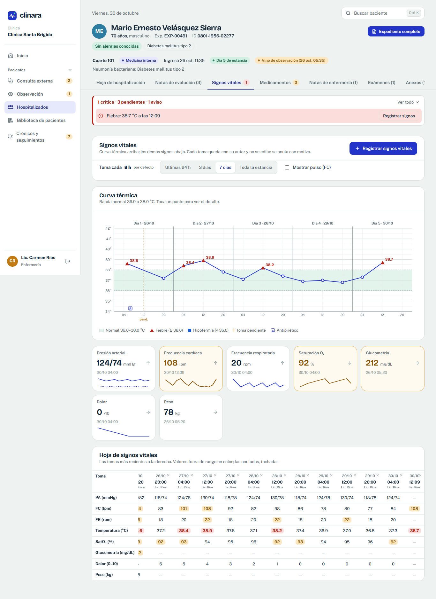
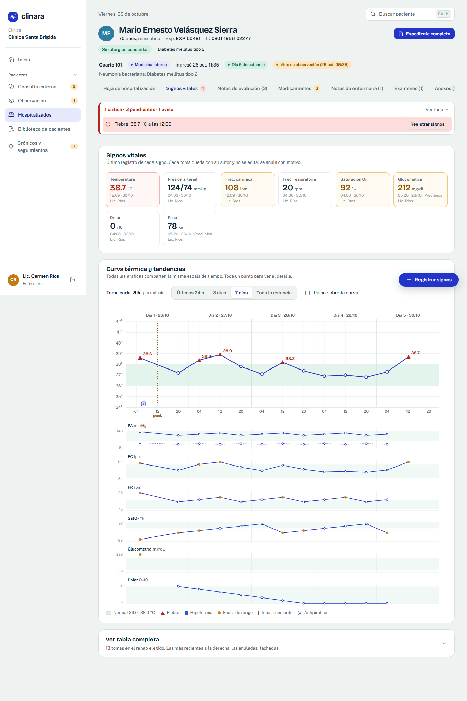
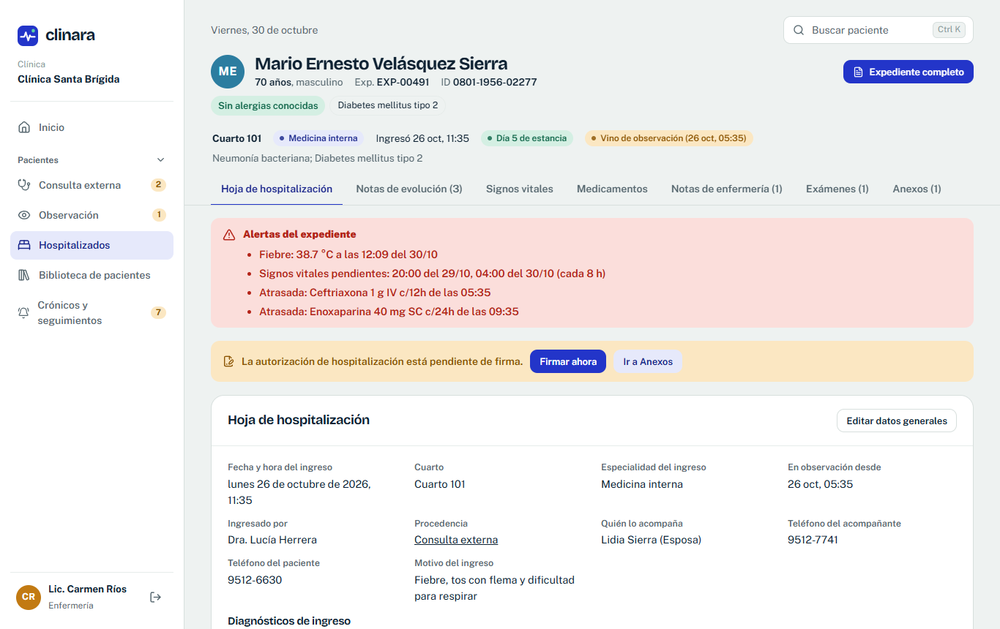
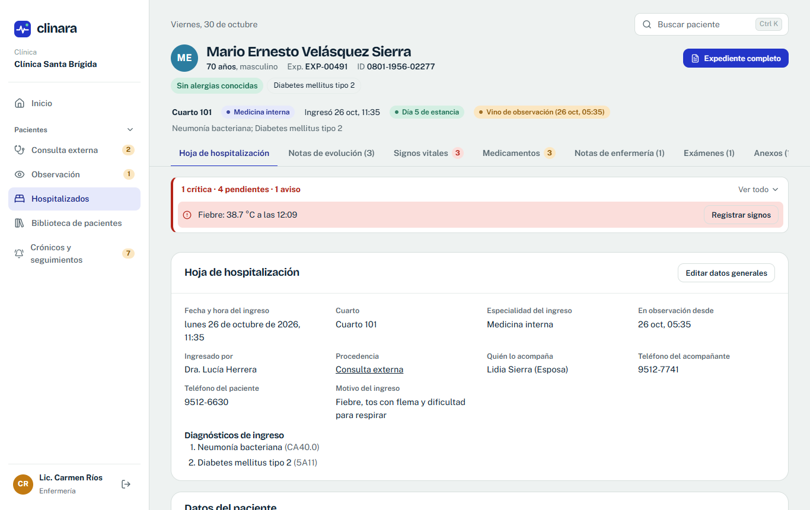

# Reporte: correcciones de la ronda 3

Rama `correcciones-emil-5`, integrada a `main`. Un commit por punto (ver `git log`). Plan previo en `PLAN_RONDA3.md`.

Verificación final: `npx tsc -b` sin errores, `oxlint` con 34 avisos (la línea base era 37; ninguno nuevo), `npm test` **190 de 190** pruebas, `npm run build` correcto (el aviso de tamaño del paquete ya existía). Cada punto se revisó en el navegador con el rol que corresponde, en escritorio y a 390 px.

## 1. Estado por punto

| Punto | Estado | Archivos principales | Cómo probarlo |
|---|---|---|---|
| **AD1** Contactos de la clínica | Hecho | `src/components/Contacts.tsx`, `src/app/Settings.tsx`, `server/routes/settings.ts`, `src/lib/format.ts` (`contactLine`, `clinicWhatsapp`), `DocHeader`, `Booking` | Roberto Aguilar → Configuración → Clínica → «Agregar contacto» (WhatsApp). Imprime una receta o un recibo: sale «Tel. … · WhatsApp …». La reserva en línea muestra «Llamar» y «WhatsApp». |
| **AD2** Vigencia de la receta por médico | Hecho | `server/prefs.ts`, `src/components/RxValidity.tsx`, `src/app/MyConfig.tsx`, `src/app/Prescriptions.tsx`, `Consultation.tsx` | Dra. Herrera → Mi configuración → Preferencias: vigencia 15 días. Firma una consulta con receta: la receta dice 15 días. En la misma consulta cambia «Vigencia de esta receta» a 60: sólo esa receta cambia. |
| **AD3** Camas: libre, ocupada o fuera de servicio | Hecho | `src/components/BedFields.tsx`, `src/app/Settings.tsx` (Camas), `src/app/Inpatients.tsx`, `server/routes/inpatient.ts` | Configuración → Camas: estado de cada cama, «Fuera de servicio» con nota. Al ingresar sólo se ofrecen camas libres; la especialidad es la del médico (editable) y se ve en la tarjeta de la cama. |
| **AD4** Vademécum | Hecho (importación en CSV) | `src/components/DrugForm.tsx`, `src/app/Settings.tsx` (Vademécum), `server/routes/drugs.ts`, `src/lib/drugProvider.ts`, `docs/VADEMECUM_EXTERNO.md` | Configuración → Vademécum: tabla completa, «Agregar medicamento», «Importar» con la plantilla (Excel la guarda como CSV). El médico agrega desde Mi configuración → Mi vademécum. |
| **AD5** Varios roles y selector de vista | Hecho | `src/lib/permissions.ts`, `src/components/ViewSwitch.tsx`, `src/app/Staff.tsx` (Roles), `server/app.ts` (`/api/me/view`, `hasRoleSql`) | Roberto → Personal → «Roles» de la Dra. Herrera → marca Administración. Ella entra: en Inicio y en el pie del menú cambia entre «Vista de médico» y «Vista de administrador». Una ruta del otro rol ofrece cambiar de vista. |
| **AD6** Encabezados y pestañas fijos | Hecho | `src/modules.css` (`tabs--sticky`, `table--sticky`), Personal, Biblioteca, Caja, Bitácora, expediente | Baja en Personal o en la Biblioteca: las pestañas y los títulos de la tabla quedan arriba. |
| **AD7** Bitácora propia y de todos | Hecho | `src/app/Activity.tsx`, `src/lib/audit.ts`, `server/app.ts` (`/api/audit`, `/api/audit/mine`) | Cualquier usuario → Mi configuración → Mi actividad. Roberto → Personal → Bitácora: filtros por persona, rol, tipo, paciente y fechas; exporta CSV. |
| **AD8** Filtros de la Biblioteca | Hecho | `src/app/Patients.tsx`, `src/lib/patientFilters.ts` | Biblioteca: filtros en frases («de 40 a 60 años»), atajos de un toque, fechas rápidas y el resumen de lo filtrado. |
| **AD9** Caja | Hecho | `src/app/Billing.tsx`, `server/routes/billing.ts`, `src/lib/billing.ts`, Configuración → Formas de pago | Sofía Mejía → Caja → «Nuevo cobro» → «Servicio nuevo»: «Sutura», L 400, «Guardar en la lista de servicios» marcado → Transferencia con banco y referencia. El servicio queda en Configuración → Servicios. Abonos y «Saldos pendientes». |
| **EN1** Signos vitales | Hecho | `src/app/VitalsSheet.tsx`, `src/app/InpatientFile.tsx` (orden de pestañas), `src/app/FullRecord.tsx`, `src/clinical.css` | Expediente de un hospitalizado → «Signos vitales» (ahora antes de las notas): último registro en tarjetas, curva y minigráficas con la misma escala de tiempo, «Ver tabla completa» plegada y «+ Registrar signos» fijo. «Expediente completo»: la hoja de signos va antes de las notas. Capturas abajo. |
| **EN2** Alertas | Hecho | `src/lib/alerts.ts`, `src/app/MedAlerts.tsx` (`AlertBar`), `src/app/WardAlerts.tsx`, `src/app/Dashboard.tsx`, `server/routes/inpatient.ts` (`/api/inpatient/alerts`) | Expediente: barra «1 crítica · 4 pendientes · 1 aviso», lo crítico abierto, cada alerta con su acción («Registrar dosis» abre esa dosis). Contadores en las pestañas. Carmen Ríos → Inicio → «Pendientes por paciente». Una dosis «No aplicada» con motivo deja de alertar. |
| **MC1** Ingreso con firma inmediata | Hecho | `src/app/ConsentFlow.tsx`, `src/app/InpatientFile.tsx`, `src/app/ConsentSigning.tsx` | Dra. Herrera firma una consulta con «Hospitalizar» → elige cama → se abre la autorización en la vista de firma en pantalla con «Firmar ahora», «Imprimir para firmar en papel» y «Firmar después» → llega al expediente. Igual desde observación. |
| **MC2** Autorización quirúrgica | Hecho | `src/app/Authorization.tsx`, `ConsentFlow.tsx`, `InpatientFile.tsx` (`ProcedureNoteForm`) | Nota de procedimiento → «Procedimiento mayor» → la autorización toma el procedimiento escrito y el diagnóstico actual (editables), se firma en el momento y vuelve a la nota. |
| **MC3** Nota de procedimiento | Hecho | `InpatientFile.tsx` (`ProcedureNoteForm`), `server/routes/inpatient.ts` | Infiltración (menor, casilla desmarcada): se guarda sin aviso. Marca «Procedimiento mayor»: pide la autorización firmada (o urgencia con justificación). |
| **MC4** Formatos de nota | Hecho | `InpatientFile.tsx` (`NoteEditor`), `MyConfig.tsx` | Nueva nota de evolución: «Estándar» primero y por defecto, y «SOAP». Se elige el de cada médico en Mi configuración. |
| **MC5** Nota de egreso | Hecho | `src/app/DischargeNote.tsx`, `server/routes/inpatient.ts` (`/discharge-preview`, `/discharge`), `server/epicrisis.ts`, `src/app/Epicrisis.tsx` | Hospitalizado → Notas → «Egreso»: la hoja de la epicrisis en su orden (1. datos del ingreso … 11. indicaciones), HEA precargada, medicamentos al alta con «+ Agregar medicamento» y «Pasar a la receta», exámenes pendientes. «Dar de alta y emitir la epicrisis»: cama libre, receta y epicrisis emitida con el mismo texto. Diagnóstico de egreso con etiqueta CIE-11. |
| **MC6** Mi configuración | Hecho | `src/app/MyConfig.tsx`, `server/routes/me.ts`, `src/components/MarkImage.tsx`, `src/app/MyExams.tsx` | Médico → Configuración: datos profesionales, firma y sello (con historial), horario, vademécum, sets, exámenes frecuentes, preferencias, seguridad y actividad. Recepción, enfermería y administración: sólo Seguridad y Mi actividad. |
| **MC7** Menú del médico | Hecho | `src/app/AppShell.tsx` | Inicio → Agenda → Recetas → Cobrar → Pacientes ▾ → Configuración. |
| **MI1** Consultorio | Hecho | `src/lib/permissions.ts`, `server/app.ts` (`assertRoleFits`), `server/routes/platform.ts`, `server/routes/settings.ts`, `src/app/Staff.tsx`, `src/app/AppShell.tsx`, migración v42 | Dra. Ana López: en Inicio cambia de vista. Médico: menú de MC7. Administrador: Inicio, Agenda, Caja, Reportes, Personal y Configuración del consultorio. Personal → «Agregar personal» → Enfermería o Asistente. Sin camas no hay hospitalización. |
| **DM1** Datos demo | Hecho | `server/demoData.ts`, `server/seed-demo.ts`, `server/app.ts` (`/api/cron/demo`, `/api/admin/seed-demo`), `vercel.json`, migración v43 | Entra con cualquier usuario demo cualquier día: hay citas, sala de espera, listos, en consulta, atendidos, observados y hospitalizados. `npm run seed:demo` dos veces no duplica nada. |

## 2. Base de datos y migraciones

Todo aditivo: no se borró ninguna columna ni registro (la única excepción es DM1, sólo pacientes demo en clínicas marcadas, con respaldo). Probado sobre una copia de la base v31: pasa a v43 en 0.35 s con los mismos conteos de pacientes, consultas, recetas, cobros, estancias, notas, personal y archivos.

| Versión | Cambio |
|---|---|
| v32 (AD2) | `prescriptions.validity_days`; cada médico recibe en `staff.prefs.rxValidityDays` la vigencia que tenía su clínica; las recetas emitidas guardan la suya. `clinics.rx_validity_days` se conserva sin editarse. |
| v33 (AD5) | `staff.roles` (todos los roles; `staff.role` es el activo) y `audit.role`. Migración: `roles = [role]`. |
| v34 (MC6) | `staff.doc_name`, `stamp`, `signature_id`, `stamp_id`, `pin_hash`; tabla `staff_marks` (historial de firma y sello); recetas y constancias guardan qué firma y sello llevaron. |
| v35 (AD1) | `clinics.contacts`, `docs_whatsapp`. El teléfono actual pasa a ser el contacto principal. |
| v36 (AD3) | `hospitalizations.specialty`; `beds.specialty` deja de ser obligatoria y su valor se guarda en `beds.archived_specialty`; `beds.out_of_service_note`. |
| v37 (AD4) | `clinic_drugs.usual_dose`, `usual_use`. |
| v38 (AD7) | `audit.patient_id`, `audit.kind` con índices. |
| v39 (AD9) | `clinics.payment_methods`, `payments.bank`, `amount_paid`, tabla `payment_installments`, `services.created_by/created_at`, métodos `deposit` y `other`. **Cobros «por cobrar»**: no eran registros (se calculaban en pantalla), así que no hubo nada que archivar. Las clínicas existentes quedan con Efectivo y Transferencia más las formas que ya habían usado (para no romper su historial). |
| v40–v41 | Ronda 4 (ver su reporte). |
| v42 (MI1) | El médico titular de cada consultorio recibe también el rol Administración (una sola vez). |
| v43 (DM1) | `clinics.is_demo` (sólo Clínica Santa Brígida y Consultorio Dra. Ana López, y sólo si todo su personal es `@demo.clinara`) y tabla `demo_backups`. |

## 3. Valores por defecto (sección 6) y decisiones propias

Valores por defecto usados tal cual: vigencia 30 días por médico, editable por receta; camas fuera de servicio como tercer estado manual; especialidad del ingreso = la del médico, editable; formas de pago Efectivo y Transferencia; «Guardar en la lista de servicios» marcada; «Cobrar» en el menú del médico en los dos modos; formato de nota Estándar; procedimiento mayor desmarcado; demo de 30 días atrás a 60 adelante con tarea diaria; Dr. Daniel Fúnez Castillo.

Decisiones propias:
- **Enfermería ya no cobra** (tabla de permisos, AD9).
- **Importación del vademécum en CSV**: Excel lo exporta directo; leer `.xlsx` habría requerido una librería más.
- **EN2**: las órdenes sin revisar pasan a críticas después de **30 minutos**. «Pendientes por paciente» reemplaza el panel «Órdenes nuevas» del inicio de enfermería (las órdenes nuevas siguen ahí, junto con dosis, signos y exámenes). Las dosis atrasadas se cuentan en las últimas 24 horas (antes sólo las de hoy).
- **EN1**: en pantalla la cuadrícula de la curva es por grado; la versión impresa conserva la de cada 0.5 °C.
- **MC5**: al guardar la nota de egreso en hospitalización la epicrisis sale **emitida** con el mismo contenido (ya no hay un segundo formulario). Si falta algo obligatorio queda como borrador, como antes. Los exámenes pedidos al alta como «Externo» no van a la bandeja de enfermería.
- **MI1**: en la vista de administrador del consultorio se ocultan las opciones de «Pacientes». Al convertir el consultorio en clínica, el titular deja la administración a la persona nueva y sigue como médico (como antes).
- **DM1**: la tarea diaria **regenera la ventana completa** (borra y vuelve a generar con la misma semilla) en vez de avanzar día por día: el resultado es el mismo (siempre 30 días atrás y 60 adelante, la sala de espera de hoy, estancias con notas y signos hasta hoy) y no se acumulan datos. Lo que alguien pruebe en las clínicas demo se borra a las 05:00. A los médicos demo que no tenían sábado o domingo se les **agregó una mañana de fin de semana** (lo demás de su horario no cambió) para que cualquier usuario vea citas el domingo. La Clínica San Lucas (demo de aislamiento entre clínicas) no está marcada y no se toca.
- **DM1**: los estados de hoy (atendidos, en consulta, listos, en sala, por llegar) se reparten por orden de las citas, no por la hora real: si alguien entra antes de la primera cita del día ya verá atendidos.

## 4. Credenciales demo (contraseña de todos: `demo1234`)

| Usuario | Correo | Rol |
|---|---|---|
| Roberto Aguilar | admin@demo.clinara | Administración (Clínica Santa Brígida) |
| Sofía Mejía | smejia@demo.clinara | Recepción |
| Lic. Carmen Ríos | crios@demo.clinara | Enfermería |
| Dra. Lucía Herrera | lherrera@demo.clinara | Médico, Medicina interna |
| Dr. Andrés Paz | apaz@demo.clinara | Médico, Pediatría |
| Dra. Mariela Zúniga | mzuniga@demo.clinara | Médico, Ginecología y obstetricia |
| **Dr. Daniel Fúnez Castillo** | **dfunez@demo.clinara** | Médico, Medicina general (CMH-10457), horario de lunes a domingo |
| Dra. Ana López | alopez@demo.clinara | Consultorio: médico y administración |
| Karla Mendoza | asistente@demo.clinara | Asistente del consultorio |
| Soporte Clinara | superadmin@demo.clinara | Plataforma |

## 5. Capturas antes y después

**EN1, Signos vitales.** Antes (tabla siempre abierta, tarjetas con minigráficas sueltas, pestaña después de las notas):

Después (último registro arriba, curva con más aire, minigráficas alineadas en la misma escala, tabla plegada, botón fijo):

A 390 px: [antes](docs/capturas/en1-antes-movil.png) · [después](docs/capturas/en1-despues-movil.png) (tarjetas en 2 columnas; la curva y las minigráficas se desplazan juntas, con el nombre de cada signo fijo a la izquierda).

**EN2, Alertas.** Antes (recuadro rojo, una línea por dosis y por toma):

Después (barra compacta, sólo lo crítico abierto, contadores en las pestañas):

Abierta: [captura](docs/capturas/en2-despues-abierta.png) · A 390 px: [captura](docs/capturas/en2-movil.png) · Inicio de enfermería: [Pendientes por paciente](docs/capturas/en2-inicio.png)

## 6. Errores y mejoras encontrados fuera de la lista

- Las recetas emitidas **no se podían anular**: ahora se anulan con motivo y se ofrece «Emitir una nueva» (ronda 4, AN1).
- El diagnóstico de egreso decía «CIE-10» aunque se eligiera de la CIE-11: el buscador no guardaba la clasificación (corregido, MC5).
- Configuración → Camas mostraba todas las camas libres a administración (no recibía las estancias): corregido con `bedStays`.
- Dos rutas del servidor podían quedarse colgadas con PGlite al consultar el nombre del paciente dentro de una transacción (cobro de abonos y exámenes): corregido.
- Después de «Restablecer demo» el titular del consultorio quedaba sin el rol de administración y las clínicas sin marca demo: `resetDemo` ahora repite esas migraciones.
- La pestaña del expediente no quedaba en la URL: al recargar volvía a la primera. Ahora se recuerda.

## 7. Pendiente de configurar en Vercel

- Variable **`CRON_SECRET`** (cualquier valor largo): la tarea diaria de `vercel.json` (`0 11 * * *` = 05:00 en Honduras) la necesita; sin ella responde 401 y no corre.
- La primera vez, para no esperar a las 05:00: Soporte Clinara → «Restablecer demo» (ahora también genera los pacientes nuevos), o `npm run seed:demo -- .env.neon.local` desde una terminal.
